<p align="center">
  
</p>

<p align="center"><strong>Install architectures, not dependencies.</strong><br>
Code you own · Context your AI understands · MCP connections, ready.</p>

<p align="center">
  
</p>

GenPM injects complete modules — **source code + AI rules + MCP servers** — into your project from immutable Git commits. No opaque `node_modules`: the code lands in `src/`, versioned with yours, and your AI agent can read, change and extend it because every module ships the rules that explain how.

```bash
curl -fsSL https://genpm.net/install.sh | sh     # macOS / Linux
irm https://genpm.net/install.ps1 | iex          # Windows (PowerShell)

genpm add @core/auth
```

One native binary, no Node.js needed (`genpm upgrade` keeps it current). Prefer npm? `npm i -g genpm` or `npx genpm …` work too. More options: [genpm.net/docs/install](https://genpm.net/docs/install).

- **Code** lands in `src/lib/auth`, not in `node_modules`. You see it in your diff and you own it.
- **Context**: an `AGENTS.md` per module (plus Cursor, Copilot, Windsurf and Claude Code rule files), loaded only when your agent works in that folder.
- **Connections**: the MCP servers a module needs, added only with your consent.

## Use it from your AI

```bash
genpm mcp setup                                  # writes the config for the AI clients it detects
claude mcp add genpm -- genpm mcp serve          # or register it by hand (Claude Code)
```

The MCP server is built into the `genpm` binary. Without it, use `npx -y @genpm/mcp` (needs Node.js).

Then ask: *"Add GitHub login to this project with genpm."* Your agent searches, shows you the plan and installs. Setup for Cursor, VS Code, Windsurf and Codex: [genpm.net/docs/mcp](https://genpm.net/docs/mcp).

## Security

What you reviewed is what gets installed. Every package is pinned to a 40-character commit SHA and verified after download, manifests are signed by the registry, GenPM never runs package code or install scripts, writes stay inside your project, and AI rules are scanned for prompt injection. The ten invariants and how they are tested: [docs/security.md](docs/security.md) · report a vulnerability: [SECURITY.md](SECURITY.md).

## Publish a package

```bash
genpm init && genpm validate
git tag v1.0.0 && git push --tags
genpm publish
```

Your code stays on GitHub; the registry stores metadata only. Guide: [genpm.net/docs/publishing](https://genpm.net/docs/publishing).

## This repository

```
apps/
  registry/   API on Cloudflare Workers + Hono + D1 (metadata only)
  web/        genpm.net — Astro SSR on Cloudflare
packages/
  manifest/   @genpm/manifest — schema, canonical form, signatures, scanner (no I/O)
  core/       @genpm/core — resolve, fetch, plan, apply, inject, lockfile
  cli/        genpm — the CLI (thin facade over core)
  mcp/        @genpm/mcp — the MCP server (thin facade over core)
  i18n/       @genpm/i18n — ICU catalogs for en, es, pt-BR, fr, de, ja, zh-CN, ko
docs/         design and specs (Spanish)
tasks/        MVP plan and task board
```

Requirements to develop: Node 22.12+ (tsdown and Astro), pnpm 10, git 2.25+. The published `genpm` and `@genpm/mcp` run on Node 20.11+ (CI tests them on Node 20 and 22); the native `genpm` binaries are built with Bun (`pnpm --filter genpm build:bin`, ADR-025).

```bash
pnpm install
pnpm build && pnpm test      # every package
pnpm lint                    # Biome, hardcoded-text check, i18n catalogs, brand contrast
pnpm --filter @genpm/registry dev   # local registry on :8787
pnpm --filter @genpm/web dev        # genpm.net on :4321
```

Contributor rules (architecture, invariants, i18n) live in [AGENTS.md](AGENTS.md); the technical design starts at [docs/README.md](docs/README.md).

## License

The client packages (`packages/*`: `genpm`, `@genpm/mcp`, `@genpm/core`, `@genpm/manifest`, `@genpm/i18n`) are MIT-licensed. The registry (`apps/registry`) and the website (`apps/web`) are © GenPM, all rights reserved.
