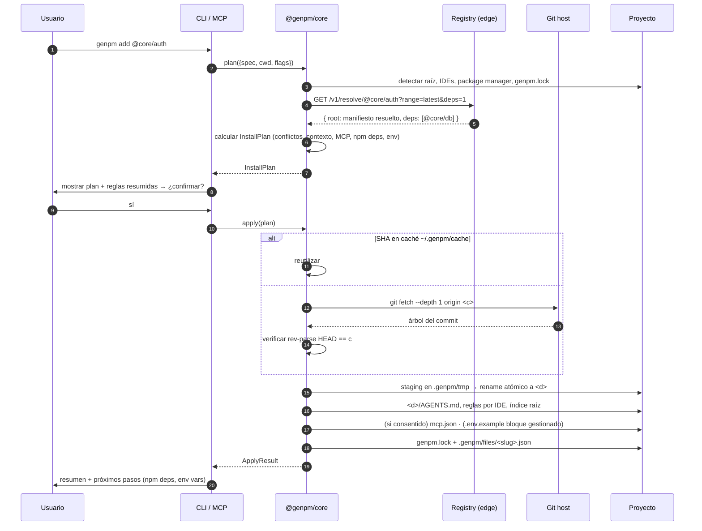

# GenPM — Arquitectura del sistema

> Estado: **v0.1 (MVP)** · Fecha: 2026-10-02 · Audiencia: ingeniería
> Documentos relacionados: [manifest-spec](manifest-spec.md) · [api-spec](api-spec.md) · [cli-mcp-spec](cli-mcp-spec.md) · [security](security.md) · [i18n](i18n.md) · [roadmap-mvp](roadmap-mvp.md) · [brainstorming (ADRs)](brainstorming.md)

---

## 1. Resumen

GenPM es un gestor de paquetes para el desarrollo asistido por IA. Un **paquete GenPM** es la unión de tres capas:

| Capa | Qué es | Dónde termina en el proyecto del usuario |
|---|---|---|
| **Code** | Código fuente de un módulo/arquitectura | `d` (p. ej. `src/lib/auth/`), commiteado por el usuario |
| **Context** | Reglas para el agente IA (`x`) | `<d>/AGENTS.md` + reglas con alcance por IDE + índice raíz |
| **Connections** | Servidores MCP que el módulo necesita (`m`) | `.mcp.json`, `.cursor/mcp.json`, `.vscode/mcp.json` (con consentimiento) |

El sistema tiene cuatro piezas: un **registry de metadatos en el edge** (no guarda archivos), un **motor compartido** (`@genpm/core`),
y dos fachadas sobre ese motor: el **CLI** y el **servidor MCP**. Una **web** (genpm.net) sirve descubrimiento y documentación.

## 2. Glosario

| Término | Definición |
|---|---|
| Manifiesto fuente | `genpm.json` en el repo del paquete, escrito por el autor. |
| Manifiesto resuelto | Manifiesto canónico generado por el registry al publicar; incluye `r`, `t` y `c` (SHA) siempre. |
| Spec | Lo que el usuario pide: `@core/auth`, `@core/auth@^1.2`, `gh:owner/repo#<sha>`. |
| Inyección | Copiar el código de un SHA a `d`, más contexto y config MCP. |
| Plan de instalación | Estructura calculada antes de escribir nada: archivos, conflictos, contexto, MCP, deps npm, env. |
| Drift | Diferencia entre un archivo inyectado y su hash original (el usuario/LLM lo modificó). |
| Registry | API Edge (Workers + D1). `reg_public` es el registro público; los privados son otros `registry_id`. |

## 3. Principios de arquitectura

1. **Git-native & headless.** El registry solo indexa metadatos y apunta a Git. El CLI descarga directamente del host Git. Coste de almacenamiento ≈ $0.
2. **Inmutabilidad verificable.** Toda instalación se ancla a un SHA de 40 caracteres (`c`). Nunca a una rama. El CLI verifica el SHA tras el fetch.
3. **El código es del usuario.** Tras inyectar, el código es fuente normal del proyecto. GenPM no lo "posee" ni lo esconde.
4. **Contexto con alcance.** Las reglas de IA viajan con el código y solo se cargan cuando el agente trabaja en esa carpeta (ADR-004).
5. **Optimizado para tokens.** Manifiesto y respuestas de máquina usan claves de 1 carácter y JSON minificado.
6. **Cero scripts.** GenPM nunca ejecuta código del paquete (no hay `postinstall`). Elimina la clase de ataque más común de npm.
7. **Un motor, varias fachadas.** CLI, MCP (y en el futuro una extensión de IDE) llaman a `@genpm/core`. Ninguna lógica se duplica.
8. **Preparado para multi-tenant.** Cada fila lleva `registry_id`; los IDs son ULID globales (ADR-011).
9. **Seguro por diseño, verificable por cualquiera.** 10 invariantes con test bloqueante, manifiestos firmados, doble escaneo ([security](security.md)).
10. **Multi-idioma desde el día 1.** 8 idiomas en web y CLI; los contratos de máquina nunca se traducen ([i18n](i18n.md)).

## 4. Vista de contexto (C4 nivel 1)

```mermaid
flowchart LR
  dev([Desarrollador]) -->|genpm add / search| CLI[genpm CLI]
  dev -->|"instala auth" en lenguaje natural| IDE[IDE con agente IA<br/>Cursor · Claude Code · VS Code]
  IDE -->|MCP stdio| MCP[@genpm/mcp]
  CLI --> CORE[@genpm/core]
  MCP --> CORE
  CORE -->|HTTPS JSON| REG[GenPM Registry<br/>Cloudflare Workers + D1]
  CORE -->|git fetch --depth 1 &lt;sha&gt;| GIT[(GitHub / GitLab<br/>repos públicos o privados)]
  CORE -->|escribe| PROJ[(Proyecto del usuario<br/>src/ · genpm.lock · AGENTS.md · mcp.json)]
  author([Autor de paquetes]) -->|git tag + genpm publish| CLI
  REG -->|resuelve tag → SHA, lee genpm.json| GIT
  web([Visitante]) --> WEB[genpm.net<br/>Astro SSR]
  WEB -->|Service Binding| REG
```

**Explicación en texto.** El desarrollador interactúa por terminal (CLI) o conversando con su IDE (que habla MCP con `@genpm/mcp`).
Ambas fachadas delegan en `@genpm/core`, que consulta el registry para *resolver* un nombre a un manifiesto con SHA, y después
descarga el código **directamente del host Git** — el registry nunca está en el camino de los bytes del código. El autor publica
creando un tag en Git y llamando a `genpm publish`; el registry verifica en el servidor (leyendo GitHub) que el manifiesto existe en ese
commit. La web lee el mismo registry por Service Binding (latencia ~0, sin pasar por Internet).

## 5. Vista de contenedores (C4 nivel 2)

| Contenedor | Tecnología | Responsabilidad | Estado / datos |
|---|---|---|---|
| `apps/registry` | Cloudflare Worker, Hono, zod | API REST `/v1`: search, resolve, packages, publish, auth, tokens | D1 (`DB`), Analytics Engine (`INSTALLS`), Cache API |
| D1 | SQLite en el edge + FTS5 | Metadatos, versiones, cuentas, scopes, tokens, patrocinios, auditoría | ~KB por versión |
| Analytics Engine | Workers Analytics Engine | Eventos de instalación de alto volumen (write-only, barato) | Rollup horario a D1 por Cron Trigger |
| `apps/web` | Astro SSR (adapter Cloudflare), Tailwind | Home, búsqueda, páginas de paquete, docs, dashboard | Sin estado propio |
| `packages/core` | Node ≥ 20.11, TS | Resolver, fetch Git, plan, apply con rollback, inyección, lockfile | Caché `~/.genpm/cache` |
| `packages/cli` | citty + @clack/prompts + picocolors | UX de terminal, `--json` | — |
| `packages/mcp` | `@modelcontextprotocol/sdk` (stdio) | Tools/resources/prompts MCP | — |
| `packages/manifest` | zod (sin I/O) | Esquemas, tipos, validaciones, códigos de error | — |
| `packages/i18n` | ICU MessageFormat + `Intl` (sin I/O) | Catálogos de 8 idiomas, negociación de locale, formateo | — |

### 5.1 Grafo de dependencias internas

```
@genpm/manifest, @genpm/i18n  ◄─┬───────────────┬──────────────┐
      ▲                         │               │              │
@genpm/core ◄── genpm (cli)     │          apps/registry   apps/web
      ▲                         │
      └──── @genpm/mcp ─────────┘
```
Regla: `manifest` no depende de nada del monorepo; `core` solo de `manifest`; `apps/*` nunca dependen de `core`
(el registry no clona repos; la web no escribe disco).

## 6. Flujos de datos

### 6.1 `genpm add @core/auth` (camino crítico)



**Pasos clave explicados.**
1. **Resolución en el servidor.** Una sola llamada `resolve?deps=1` devuelve el paquete y su clausura plana de dependencias GenPM (`g`), evitando N round-trips.
2. **Plan antes que acción.** `plan()` es puro respecto al disco (solo lee). Esto permite `--dry-run`, la confirmación del usuario y que el MCP le muestre el plan al LLM antes de ejecutar.
3. **Fetch por SHA.** Ver §7.1. El registry no participa.
4. **Escritura transaccional.** `apply()` mantiene un *journal* de operaciones; ante cualquier error revierte (borra lo creado, restaura backups de archivos modificados como `AGENTS.md`).
5. **Telemetría implícita.** La llamada a `resolve` ya cuenta como instalación (evento en Analytics Engine vía `ctx.waitUntil`); no hay ping extra.

### 6.2 `genpm publish` (autor)

```mermaid
sequenceDiagram
  autonumber
  participant A as Autor
  participant C as CLI
  participant R as Registry
  participant G as GitHub API

  A->>A: git tag v1.2.0 && git push --tags
  A->>C: genpm publish
  C->>C: validar genpm.json local, árbol limpio, tag existe en remoto (git ls-remote)
  C->>R: POST /v1/publish {name, version, repo, ref, manifestPath}  (Bearer gpm_…)
  R->>R: auth → cuenta; permisos sobre scope (ADR-006)
  R->>G: GET /repos/{o}/{r}/git/ref/tags/{ref} → tipo de ref (rechaza ramas)
  R->>G: GET /repos/{o}/{r}/commits/{ref} → SHA c
  R->>G: GET raw genpm.json @ c  → validar zod, n y v coinciden
  R->>G: GET raw <x> @ c → tamaño ≤ 16 KB, escaneo prompt-injection
  R->>G: GET /repos/{o}/{r}/license → SPDX
  R->>R: D1 batch atómico: package upsert, version, dist-tag, keywords, deps, FTS, audit
  R->>R: purgar caché de /packages y /resolve de ese nombre
  R-->>C: 201 { manifiesto resuelto, scan_status }
```

**Principio:** el registry **nunca confía en el manifiesto que envía el cliente**. Solo recibe *coordenadas* (repo + ref) y lee la
verdad desde GitHub en el commit resuelto. Un token robado no permite publicar código que no esté en un repo controlado por el scope.

### 6.3 Búsqueda (CLI, MCP y web)

1. Cliente → `GET /v1/search?q=auth+stripe&limit=10`.
2. Worker: Cache API (clave = URL normalizada, TTL 30 s, `stale-while-revalidate` 300 s).
3. Miss → D1: `packages_fts MATCH` con términos escapados + `bm25` ponderado × `popularity_score` precalculado (ver api-spec §6).
4. Respuesta compacta (claves de 1 carácter si `Accept: application/vnd.genpm+json`). Patrocinado: campo separado `sp`, solo si el cliente lo pide (`sponsored=1`, lo hace la web y el CLI interactivo; nunca el MCP — ADR-010).

### 6.4 Instalación conversacional vía MCP

```
Usuario (en Cursor): "Añade autenticación con GitHub a este proyecto"
  └─ LLM → tool genpm_search {query:"auth github oauth"}           → 3 candidatos compactos
  └─ LLM → tool genpm_info   {name:"@core/auth"}                   → manifiesto + resumen de reglas + deps + env
  └─ LLM → tool genpm_add    {name:"@core/auth", dryRun:true}      → InstallPlan (archivos, conflictos, pendingMcp)
  └─ LLM explica el plan al usuario; el cliente MCP pide aprobación de la tool
  └─ LLM → tool genpm_add    {name:"@core/auth"}                   → ApplyResult
  └─ LLM lee src/lib/auth/AGENTS.md (ya en disco) y cablea el módulo en la app
  └─ LLM → (si pendingMcp) pregunta al usuario y llama genpm_add {…, allowMcp:true} o indica el paso manual
```
La raíz del proyecto la determina el servidor MCP con este orden: `roots/list` del cliente MCP → `GENPM_CWD` → `process.cwd()`.

### 6.5 Login (device flow)

1. `genpm login` → el CLI inicia **GitHub OAuth Device Flow** con el `client_id` público de la OAuth App de GenPM (scopes: `read:user read:org`).
2. Muestra `user_code` y abre `https://github.com/login/device`.
3. Con el `access_token` de GitHub, el CLI llama `POST /v1/auth/github/exchange`.
4. El registry valida el token contra `GET /user` y `GET /user/orgs`, hace upsert de `accounts` + `memberships`, **descarta el token de GitHub** (no se almacena) y emite un token GenPM `gpm_…` (se guarda solo su hash).
5. El CLI guarda el token en `~/.genpm/auth.json` (permisos `0600`), o en el llavero del SO si está disponible (post-MVP).

### 6.6 Actualización con drift (diseño v0.2)

```
genpm update @core/auth
  base   = árbol upstream @ c_instalado  (caché o re-fetch por SHA)
  theirs = árbol upstream @ c_nuevo
  ours   = archivos locales en <d>
  por archivo:
    hash(ours) == hash_registrado  → sobrescribir con theirs (sin drift)
    base == theirs                 → mantener ours (upstream no cambió)
    si no                          → git merge-file ours base theirs  (marcadores de conflicto)
  nuevos upstream → crear · borrados upstream sin drift → borrar · con drift → conservar y avisar
  actualizar genpm.lock (c, v) y .genpm/files
```
`genpm_diff` (MCP) devuelve el diff upstream `base..theirs` ya remapeado a `<d>` para que el LLM lo aplique semánticamente.

## 7. Detalles del motor (`@genpm/core`)

### 7.1 Estrategia de fetch

Prioridad:
1. **Caché inmutable**: `~/.genpm/cache/<host>/<owner>/<repo>/<sha>/`. Un SHA nunca cambia → nunca se invalida. Habilita instalación offline y reinstalaciones instantáneas.
2. **Git por SHA** (requiere `git` ≥ 2.25):
   ```bash
   git init -q <tmp>
   git -C <tmp> remote add origin <r>
   # si el paquete vive en un subdirectorio (i != "."), partial clone + sparse:
   git -C <tmp> sparse-checkout set --no-cone <i>
   git -C <tmp> fetch -q --depth 1 --filter=blob:none origin <c>
   git -C <tmp> checkout -q FETCH_HEAD
   test "$(git -C <tmp> rev-parse HEAD)" = "<c>"   # o E_INTEGRITY
   ```
   GitHub y GitLab permiten fetch por SHA (`uploadpack.allowReachableSHA1InWant`). `git clone --depth 1 --branch` solo sirve para tags, por eso no se usa.
3. **Fallback tarball** (sin `git` instalado o host que no permite SHA-in-want): `https://codeload.github.com/<o>/<r>/tar.gz/<c>`. La URL ya está anclada al SHA.

Las credenciales son las del usuario (SSH agent / credential helper) → repos privados funcionan sin que GenPM toque secretos (ADR-012).
Variables de entorno de git endurecidas en el subproceso: `GIT_TERMINAL_PROMPT=0`, `GIT_CONFIG_NOSYSTEM=1`, `-c core.hooksPath=/dev/null`,
`-c protocol.file.allow=never` (evita ataques con submódulos/URLs `file://`).

### 7.2 Copia segura

- Origen: `<cache>/<i>`; destino: `<root>/<d>` (o `--dest`).
- `safePath(root, d)`: normaliza, exige ruta relativa, prohíbe `..`, rutas absolutas, `~`, unidades Windows, y destinos dentro de `.git/`, `node_modules/`, `.genpm/`.
- Exclusiones duras: `.git/`, `.github/`, `genpm.json`, `.genpmignore`, `node_modules/`. Exclusiones del autor: `.genpmignore` (sintaxis gitignore).
- **Symlinks: se rechazan** (`E_PATH_UNSAFE`). Archivos especiales (FIFOs, devices): se omiten.
- Límites: 2 000 archivos, 20 MB por paquete (configurables con `--max-size` para paquetes grandes y legítimos).
- Conflicto: si `<d>` existe y no está vacío → `E_DEST_CONFLICT` (salvo `--force`, que hace backup en `.genpm/backup/<timestamp>/`).
- Escritura en staging `<root>/.genpm/tmp/<id>/` y `rename()` atómico (mismo filesystem).

### 7.3 Inyección de contexto (ADR-004)

| Cliente detectado | Señal de detección | Archivo escrito | Mecanismo de alcance |
|---|---|---|---|
| Cualquiera (siempre) | — | `<d>/AGENTS.md` (copia de `x`) | Lectura anidada de AGENTS.md |
| Cualquiera (siempre) | — | `AGENTS.md` raíz: bloque índice | 1 línea por paquete |
| Claude Code | `CLAUDE.md` o `.claude/` | `<d>/CLAUDE.md` = `@AGENTS.md`; bloque índice en `CLAUDE.md` raíz | Carga bajo demanda de CLAUDE.md en subdirectorios |
| Cursor | `.cursor/` o `.cursorrules` | `.cursor/rules/genpm-<slug>.mdc` | frontmatter `globs: <d>/**`, `alwaysApply: false` |
| GitHub Copilot | `.github/copilot-instructions.md` o `.vscode/` | `.github/instructions/genpm-<slug>.instructions.md` | frontmatter `applyTo: "<d>/**"` |
| Windsurf | `.windsurf/` o `.windsurfrules` | `.windsurf/rules/genpm-<slug>.md` | frontmatter `trigger: glob`, `globs: <d>/**` |

Override: `.genpmrc` → `clients=cursor,claude` o flag `--clients`. Los bloques gestionados usan marcadores idempotentes:

```md
<!-- genpm:index:start -->
## GenPM packages
- @core/auth@1.2.0 → src/lib/auth (rules: src/lib/auth/AGENTS.md)
- @core/db@1.0.3 → src/lib/db (rules: src/lib/db/AGENTS.md)
<!-- genpm:index:end -->
```
GenPM solo edita entre sus marcadores; nunca toca el resto del archivo.

### 7.4 Config MCP del proyecto (ADR-009)

| Cliente | Archivo de proyecto | Forma |
|---|---|---|
| Claude Code | `.mcp.json` | `{"mcpServers":{"<n>":{"command","args","env"}}}` |
| Cursor | `.cursor/mcp.json` | igual que arriba |
| VS Code | `.vscode/mcp.json` | `{"servers":{"<n>":{"type":"stdio","command","args","env"}}}` |

Merge JSON no destructivo; si ya existe un servidor con el mismo nombre y distinta config → aviso y no se sobrescribe.
Los `env` se escriben como referencias (`"${env:STRIPE_SECRET_KEY}"` donde el cliente lo soporte), nunca valores.

### 7.5 Lockfile y estado

```
my-app/
├── genpm.lock                     # procedencia (1 paquete por línea, diff-friendly)
├── .genpm/
│   ├── files/core__auth.json      # {ruta: sha256} por archivo inyectado → detección de drift (commitear)
│   ├── tmp/                       # staging (gitignored)
│   └── backup/                    # backups de --force (gitignored)
├── AGENTS.md                      # bloque índice gestionado
├── .cursor/rules/genpm-core-auth.mdc
└── src/lib/auth/
    ├── AGENTS.md                  # reglas del paquete
    ├── CLAUDE.md                  # "@AGENTS.md"
    └── …código…
```
Formato completo en [manifest-spec §6](manifest-spec.md#6-genpmlock-proyecto-consumidor).

### 7.6 Dependencias

- **GenPM → GenPM (`g`)**: resolución plana en el servidor; se elige la versión más alta que satisface todos los rangos; si no existe → `E_RANGE_UNSATISFIED` con el árbol de conflicto. Ya instalado y compatible → se omite.
- **GenPM → npm (`p`)**: GenPM no instala paquetes npm por sí mismo. Detecta el package manager (`pnpm-lock.yaml`, `package-lock.json`, `yarn.lock`, `bun.lock[b]`) y propone el comando; lo ejecuta solo con confirmación o `--install-deps`. Rangos ya satisfechos en `package.json` se omiten.
- **Variables de entorno (`e`)**: se añaden como bloque gestionado a `.env.example` (nombres vacíos), nunca a `.env`.

## 8. Seguridad — modelo de amenazas

> Resumen. La especificación normativa (invariantes, escaneo, firma, cadena de suministro, respuesta a incidentes) está en [security.md](security.md).

| Amenaza | Vector | Mitigación |
|---|---|---|
| Código mutado tras publicar | `git tag -f` | Instalación por SHA `c` + verificación `rev-parse`; auditoría diaria que compara tag→SHA |
| Publicación suplantada | Token robado / scope ajeno | Scope = owner GitHub; registry lee el manifiesto de GitHub, no del cliente; tokens con hash y expiración |
| Path traversal / sobrescritura | `d: "../../.ssh"`, symlinks | `safePath`, rechazo de symlinks, staging + rename |
| Ejecución de código en instalación | Scripts | No existen. Hooks de git desactivados en el subproceso |
| Prompt injection en reglas | `x` malicioso | Escaneo al publicar, límite 16 KB, cuarentena, resumen visible antes de confirmar (ADR-008) |
| MCP malicioso | `m` con comando arbitrario | Consentimiento separado, comando completo visible, nunca valores de secretos (ADR-009) |
| Abuso del API | Scraping / DoS | Rate Limiting binding por IP y por token, Cache API, límites de payload |
| Typosquatting | `@c0re/auth` | Scopes obligatorios, lista de scopes reservados, distancia de Levenshtein en publish → revisión manual |
| Fuga de secretos | `.env` en paquetes | Escaneo de patrones de secretos en publish (advertencia), `.env*` excluido por defecto en la copia |
| SSRF desde el registry | `r` apuntando a red interna | `r` debe ser `https://github.com/<owner>/<repo>` (MVP); allowlist de hosts |
| Manifiesto alterado en tránsito / CDN | DNS, MITM, caché envenenada | Firma Ed25519 de manifiestos verificada por el cliente (INV-8) |
| Auto-ejecución indirecta | `postinstall` en un `package.json` inyectado, `.envrc`, `.vscode/tasks.json` | Bloqueo en publish y en cliente (security §3.1) |
| Repojacking | Repo borrado y recreado con el mismo nombre | `git_repo_id` numérico + SHA pinning |

## 9. Decisiones tecnológicas

| Área | Elección | Alternativas descartadas | Por qué |
|---|---|---|---|
| Monorepo | pnpm workspaces + Turborepo | Nx, npm workspaces | Simple, caché de builds, estándar de facto en TS |
| Lint/format | Biome | ESLint + Prettier | Una herramienta, 20× más rápida, config mínima |
| Tests | Vitest + `@cloudflare/vitest-pool-workers` | Jest | ESM nativo; tests del Worker en runtime real (workerd) |
| API framework | Hono | itty-router, Workers puros | Tipado de rutas, middleware, validador zod, RPC client opcional |
| Base de datos | D1 + FTS5 | Turso, Postgres (Neon), KV | Mismo edge que el Worker, SQL relacional, FTS nativo, DB-por-tenant viable |
| Contadores | Analytics Engine → rollup D1 | Escribir en D1 por instalación | Las escrituras D1 son caras y serializadas; AE absorbe ráfagas |
| Caché | Cache API + `Cache-Control` | KV | Versiones exactas son inmutables → caché HTTP perfecta; KV añade coste y consistencia eventual |
| Validación | zod (compartido) | TypeBox, valibot | Un esquema para API, CLI, MCP y web; genera JSON Schema |
| CLI args / prompts | citty + @clack/prompts | commander, inquirer | Ligeros, ESM, UX moderna |
| Build CLI/MCP | tsdown (o tsup) | tsc puro | Bundle único, arranque rápido con `npx` |
| Binario nativo del CLI | `bun build --compile` sobre el bundle de tsdown | Node SEA, pkg, deno compile | Compilación cruzada de las 8 plataformas desde un runner, ESM y chunks dinámicos de i18n sin cambios (ADR-025) |
| MCP | `@modelcontextprotocol/sdk` stdio | Python SDK | Mismo lenguaje que core |
| Web | Astro SSR en Cloudflare + Tailwind | Next.js en Vercel | SEO de páginas de paquete, islas, mismo proveedor que el API (Service Binding) |
| Docs web | Starlight (dentro de Astro) | Docusaurus | Mismo stack, markdown de `/docs` reutilizable |
| IDs | ULID con prefijo (`pkg_01J…`) | UUIDv4, autoincrement | Ordenables, globales (multi-DB), legibles en logs |

## 10. Requisitos no funcionales

| Métrica | Objetivo MVP |
|---|---|
| `GET /v1/resolve` p95 (caché caliente) | < 50 ms |
| `GET /v1/search` p95 | < 150 ms |
| `genpm add` (paquete 100 archivos, caché fría, buena red) | < 5 s |
| `genpm add` (caché caliente) | < 1 s |
| Arranque del servidor MCP | < 500 ms |
| Disponibilidad registry | 99.9 % (SLA de Cloudflare) |
| Coste mensual a 100k instalaciones/mes | ≈ $5 (Workers Paid) — verificar precios vigentes de Workers/D1 |
| Compatibilidad | macOS, Linux, Windows (rutas normalizadas con `path.posix` en manifiestos) |

## 11. Observabilidad

- **Workers Logs** (logs estructurados JSON: `reqId`, `route`, `registry_id`, `account_id`, `status`, `ms`).
- **Analytics Engine**: `installs` (pkg, version, client: cli|mcp, cli_version, país), `searches` (query normalizada, nº resultados — detecta demanda no cubierta).
- **Errores**: Sentry vía `toucan-js` en el Worker (opcional en MVP).
- **CLI**: `--verbose` y `GENPM_DEBUG=1`; nunca envía logs remotos.
- **Panel interno**: consulta SQL a Analytics Engine; dashboard en la web (`/admin`, solo staff) post-MVP.

## 12. Escalabilidad y camino a B2B SaaS

| Etapa | Cambio | ¿Migración destructiva? |
|---|---|---|
| MVP | `reg_public`, `visibility='public'`, roles básicos | — |
| Teams (v1) | Registros privados *shared*: nuevas filas en `registries`; tablas `teams`, `team_members`, `package_grants`; `visibility IN ('internal','private')` | No — tablas y filas aditivas |
| Enterprise | Tenancy dedicada: D1 por cliente con el mismo esquema, servido por Workers for Platforms; SSO (SAML/OIDC), SCIM → `memberships.source` | No — se copian filas por `registry_id`; IDs globales no colisionan |
| Routing en clientes | `.genpmrc`: `@acme:registry=https://acme.genpm.net` + token por registry (como npm) | No — diseñado desde el día 1 en core |

Lo que **sí** sería destructivo en SQLite (requiere reconstruir tablas) y por eso se fija ahora: tipo de PK, restricciones `UNIQUE`/`CHECK`
y la semántica de propiedad. Por eso: PK `TEXT` ULID, unicidad `(registry_id, full_name)`, `owner_id` polimórfico usuario/org vía `accounts`.

## 13. Riesgos técnicos

| Riesgo | Prob. | Impacto | Mitigación |
|---|---|---|---|
| Rate limit de GitHub API en publish | Media | Medio | GitHub App con token de instalación (5 000 req/h); publish es poco frecuente |
| Rate limit de GitHub en git fetch masivo (CI) | Baja | Medio | Caché local; credenciales del usuario; fallback tarball |
| Limitaciones de D1 con tablas virtuales FTS5 en export/backup | Media | Bajo | El índice FTS es derivado: se reconstruye desde `packages` con un script |
| Fragmentación de formatos de reglas por IDE | Alta | Medio | Adaptadores aislados en `core/inject/clients/*`, fáciles de actualizar |
| Repos que desaparecen | Media | Medio | ADR-007 (mirror R2 en v0.3) |
| Windows: rutas y permisos | Media | Medio | CI en matriz macOS/Linux/Windows desde el día 1 |
