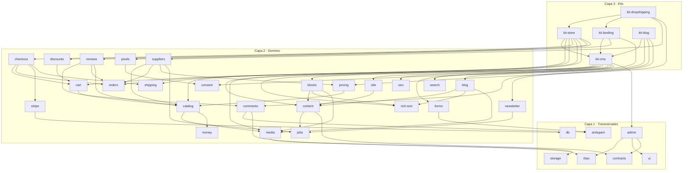

# Catálogo de paquetes y kits — plan

> Estado: **planificación** (nada implementado) · Fecha: 2026-10-05 · Decisión de fondo: [ADR-033](../brainstorming.md) (🟡 propuesta, pendiente del fundador).
> Tareas: [tasks/11-catalogo.md](../../tasks/11-catalogo.md). Las semillas `@core/{db,auth,billing,email,ai}` ya existen: [seeds/README.md](../../seeds/README.md).

## 1. Objetivo

Que un usuario (o su agente) pueda pedir **"convierte mi web en autoadministrable"**, **"móntame un blog"** o
**"quiero una tienda de dropshipping con su landing"** y GenPM inyecte una solución completa, integrada y modificable,
formada por **piezas reutilizables** que nunca se repiten entre soluciones.

| Kit (solución completa) | Lo que obtiene el usuario | Ficha |
|---|---|---|
| `@core/kit-cms` | Panel `/admin` para editar textos, imágenes, páginas, menús y ajustes de un sitio nuevo **o existente** | [kits/cms.md](kits/cms.md) |
| `@core/kit-blog` | Blog con autores, categorías, RSS, comentarios moderados, newsletter y búsqueda | [kits/blog.md](kits/blog.md) |
| `@core/kit-landing` | Landings por bloques con captación de leads, píxeles con consentimiento y (fase 2) tests A/B | [kits/landing.md](kits/landing.md) |
| `@core/kit-store` | Tienda: catálogo, carrito, checkout con Stripe, pedidos, envíos, descuentos, reseñas y área de cliente | [kits/store.md](kits/store.md) |
| `@core/kit-dropshipping` | Tienda + landings de producto + importación desde proveedores, reglas de margen y reenvío automático de pedidos | [kits/dropshipping.md](kits/dropshipping.md) |
| Kits futuros | Cursos/membresías, reservas, directorio, docs, portfolio, eventos… con las mismas piezas | [kits/futuros.md](kits/futuros.md) |

## 2. Principios de composición

1. **Un concepto, un paquete.** Si dos kits necesitan lo mismo (subir imágenes, enviar un correo, cobrar), lo usan
   del mismo paquete vía `g`. Ningún kit copia código de otro. La [matriz §6](#6-matriz-de-reutilización) lo verifica.
2. **Capas con dependencias solo hacia abajo.** Un paquete de capa N solo depende de capas < N (o de su misma capa sin
   ciclos). La capa 2 nunca importa un kit; la capa 1 nunca importa dominio.
3. **Contratos en vez de imports cruzados.** Cuando un paquete necesita "algo que provea contenido / URLs para el
   sitemap / documentos para el buscador / recursos para el admin", depende del **tipo** en `@core/contracts`, no del
   paquete concreto. Así `@core/seo` genera el sitemap de páginas, posts y productos sin depender de ninguno.
4. **Los kits son pegamento, no lógica.** Un kit contiene rutas/páginas de UI, la configuración por defecto y el
   `AGENTS.md` que explica cómo encaja todo. La lógica de negocio vive en capa 2 y se prueba allí.
5. **Registro en archivos del proyecto, nunca dentro de otro paquete.** Un paquete no edita archivos de otro
   (GenPM los actualiza con merge 3-way y las ediciones cruzadas romperían esa promesa). Los puntos de registro viven
   en archivos que son del usuario: `src/genpm/admin.ts`, `src/genpm/seo.ts`, `src/genpm/search.ts`… El `AGENTS.md` de
   cada kit dice exactamente qué línea añadir; el agente la añade.
6. **Kits que contienen kits.** `kit-dropshipping` depende de `kit-store` y `kit-landing`, que a su vez dependen de
   `kit-cms`. El resolvedor instala cada paquete **una sola vez** por proyecto (el lockfile es un mapa por nombre) y
   falla con `E_RANGE_UNSATISFIED` si dos rangos son incompatibles: por eso todos los paquetes del catálogo se versionan
   y publican coordinados por "tren" (§8).
7. **Nada de lógica de terceros opaca cuando el código puede ser tuyo.** Preferimos código inyectado y legible
   (filosofía GenPM) sobre dependencias npm grandes que ocultan el dominio. Las dependencias npm (`p`) son librerías
   técnicas (Drizzle, Stripe SDK, Tiptap, Radix), nunca "un CMS entero" — salvo como adaptador opcional (ADR-033 §3).

## 3. Capas

```
Capa 3 · Kits (rutas/UI en src/app/(<kit>))      kit-cms  kit-blog  kit-landing  kit-store  kit-dropshipping
Capa 2 · Dominio (src/lib/<x>)                     contenido · marketing · comercio · dropshipping
Capa 1 · Transversales (src/lib/<x>)               contracts rbac storage jobs antispam money stripe consent ui admin
Capa 0 · Semillas (existen)                        db auth email billing ai
```

| Capa | Documento | Paquetes |
|---|---|---|
| 0 · Semillas | [seeds/README.md](../../seeds/README.md) | `db`, `auth`, `email`, `billing`, `ai` |
| 1 · Transversales | [capa-1-transversales.md](capa-1-transversales.md) | `contracts`, `rbac`, `storage`, `jobs`, `antispam`, `money`, `stripe`, `consent`, `ui`, `admin` |
| 2 · Contenido | [capa-2-contenido.md](capa-2-contenido.md) | `content`, `media`, `rich-text`, `site`, `search`, `comments`, `blog` |
| 2 · Marketing | [capa-2-marketing.md](capa-2-marketing.md) | `seo`, `forms`, `newsletter`, `blocks`, `pixels`, `experiments` |
| 2 · Comercio | [capa-2-comercio.md](capa-2-comercio.md) | `catalog`, `cart`, `orders`, `shipping`, `checkout`, `discounts`, `reviews`, `pricing`, `suppliers` |
| 3 · Kits | [kits/](kits/) | `kit-cms`, `kit-blog`, `kit-landing`, `kit-store`, `kit-dropshipping` |

Total: **10 transversales + 22 de dominio + 5 kits = 37 paquetes nuevos**, todos bajo el scope oficial `@core`.

## 4. Grafo de dependencias (`g`)

Solo dependencias directas; las semillas se omiten salvo `db` para no saturar.



Tamaño resultante de cada instalación (directos + transitivos, semillas incluidas): `kit-cms` 19 paquetes,
`kit-blog` 23, `kit-landing` 22, `kit-store` 30, `kit-dropshipping` 36. `experiments` (F6) entra en `kit-landing` 1.1. El límite de `g` (10 por paquete) se
respeta en todos porque cada nivel agrega al anterior.

## 5. Decisiones técnicas comunes (además del stack de las semillas)

| Tema | Decisión propuesta | Por qué |
|---|---|---|
| Lógica (capas 1–2) | Igual que las semillas: TS estricto, Drizzle/Postgres, agnóstica, adaptadores Hono y Next | Reutilizable desde cualquier app y probada con PGlite |
| UI (`ui`, `admin`, `blocks`, kits) | **Next.js App Router + React 19 + Tailwind 4 + Radix** (componentes estilo shadcn, copiados, no importados de npm) | Es el destino nº 1 de los usuarios de agentes; la UI exige un framework. Astro se añade después como kits hermanos que reutilizan las mismas capas 1–2 (ADR-033 §4) |
| Dónde se instalan los kits | `d` = `src/app/(<kit>)` (route group de Next): el kit es dueño de su carpeta de rutas sin pisar las del usuario | Un paquete = un `d`; los route groups no alteran las URLs |
| Imports desde rutas | Alias `@/` → `src/` (default de `create-next-app`); la lógica sigue con imports relativos como las semillas | Las rutas anidan mucho y los relativos serían frágiles |
| Base de datos | Postgres obligatorio en comercio (transacciones, `SELECT … FOR UPDATE`); contenido admite SQLite/D1 como variante documentada | Integridad de pedidos y stock |
| Contenido localizado | Columna `locale` en entradas + fallback a idioma por defecto; los textos fijos de la UI de cada kit en `messages/<locale>.json` (mín. `en`, `es`) | Sitios multilingües sin duplicar colecciones |
| Dinero | Enteros en unidades menores + código ISO 4217 (`@core/money`); nunca `float` | Redondeo correcto, multi-moneda |
| Pagos | Solo pasarelas alojadas (Stripe Checkout / Payment Element); GenPM nunca toca datos de tarjeta | Fuera de alcance PCI SAQ-D |
| Eventos de dominio | Funciones `on<Evento>(handler)` en memoria + cola `@core/jobs` para efectos lentos (emails, proveedores) | Sin bus externo; durable cuando importa |
| Panel de administración | **Propio** (`@core/admin`), genérico sobre "recursos" registrados; Payload CMS como **adaptador opcional** del contrato de contenido | Usuarios y roles únicos, código tuyo, comercio y contenido en un solo panel (ADR-033 §3) |

## 6. Matriz de reutilización

Qué piezas usa cada kit. Una columna llena para una fila = esa pieza se escribió **una vez** y la usan varios kits.

| Paquete | cms | blog | landing | store | dropship |
|---|:-:|:-:|:-:|:-:|:-:|
| `db`, `auth`, `email` (semillas) | ● | ● | ● | ● | ● |
| `contracts`, `rbac`, `ui`, `admin` | ● | ● | ● | ● | ● |
| `storage`, `media` | ● | ● | ● | ● | ● |
| `jobs` | ● | ● | ● | ● | ● |
| `content`, `rich-text`, `blocks`, `site`, `seo`, `search`, `forms`, `antispam` | ● | ● | ● | ● | ● |
| `blog`, `newsletter` |  | ● |  |  |  |
| `comments` |  | ● |  | ● | ● |
| `consent`, `pixels`, `experiments` |  |  | ● |  | ● |
| `money`, `stripe`, `catalog`, `cart`, `orders`, `shipping`, `checkout`, `discounts`, `reviews` |  |  |  | ● | ● |
| `pricing`, `suppliers` |  |  |  |  | ● |
| `billing`, `ai` (semillas) | opc. | opc. | opc. | opc. | opc. |

`comments` sirve a los comentarios del blog y a las reseñas de la tienda; `forms` a contacto, leads de landing y
formularios de soporte; `blocks` a páginas del CMS, landings y fichas de producto largas; `jobs` a publicación
programada, newsletter y sincronización con proveedores. `billing` (suscripciones) **no** se reutiliza para pagos
únicos: lo que comparten ambos es el cliente y los webhooks de Stripe, que pasan a `@core/stripe` (ver capa 1).

## 7. Formato de cada ficha

Cada paquete se documenta con la misma estructura, que luego se convierte en su `genpm.json` y su `AGENTS.md`
([plantillas](../../seeds/templates/)):

| Campo | Contenido |
|---|---|
| **Para qué / No incluye** | Alcance y límites explícitos (lo que no hace evita solapes) |
| **Manifiesto** | `d`, `g`, `p`, `e`, `m` propuestos |
| **Tablas** | Tablas Drizzle de las que es dueño (ningún otro paquete las altera) |
| **API pública** | Lo que exporta `index.ts` |
| **Contratos** | Qué contratos de `@core/contracts` implementa o consume |
| **Reglas IA** | Las 3–6 reglas que no pueden faltar en su `AGENTS.md` |
| **Seguridad** | Riesgos propios y su mitigación |
| **Aceptación** | Pruebas concretas, además del DoD común (§8) |

## 8. Definición de "terminado"

**Paquete de capa 1–2** (igual que las semillas, [roadmap §5](../roadmap-mvp.md#5-paquetes-semilla--criterio-de-aceptación)):
1. Repo propio `github.com/genpm-net/<nombre>`, `genpm.json` con `s` en 8 idiomas, `AGENTS.md` con 5 secciones (≤ 1 500 tokens), LICENSE MIT, tag.
2. Tests Vitest + PGlite en verde, incluidos los de la ficha; `genpm validate` sin errores; puntuación de calidad ≥ 90.
3. Prueba de agente: en un proyecto con sus dependencias ya instaladas, *"Instala @core/X con genpm e intégralo"*
   deja la app compilando en < 10 min sin edición humana (Claude Code; luego Cursor).
4. Escaneo `passed` y revisión de seguridad ADR-023.

**Kit** (además de lo anterior):
1. Prueba de agente de punta a punta desde `create-next-app` vacío con el prompt del kit: app compilando, migraciones
   aplicadas y **smoke e2e Playwright** del recorrido principal en < 30 min sin edición humana.
2. Lighthouse ≥ 90 (rendimiento, accesibilidad, SEO) en las páginas públicas del kit.
3. Actualización: subir una versión menor de una pieza de capa 2 en un proyecto con el kit instalado y personalizado
   termina sin conflictos con `genpm update` (prueba de que el pegamento no duplica lógica).

**Tren de versiones:** los 37 paquetes se publican por fases (§9) con rangos `^1` entre sí; un cambio incompatible en
una pieza obliga a publicar en el mismo tren los kits que la usan (Changesets en el workspace de desarrollo, como las semillas).

## 9. Fases

| Fase | Entrega | Paquetes | Esfuerzo aprox. |
|---|---|---|---|
| **F0** Decisiones | ADR-033 aprobado, contratos, convención UI | `contracts`, `ui` | 1 semana |
| **F1** CMS | "Mi sitio es autoadministrable" | `rbac`, `storage`, `jobs`, `antispam`, `admin`, `content`, `media`, `rich-text`, `site`, `seo`, `search`, `forms`, `blocks`, **`kit-cms`** | 4–5 semanas |
| **F2** Blog | Blog completo | `blog`, `comments`, `newsletter`, **`kit-blog`** | 2 semanas |
| **F3** Landing | Landings con leads y píxeles | `consent`, `pixels`, **`kit-landing`** | 1,5 semanas |
| **F4** Tienda | Tienda con Stripe | `money`, `stripe` (+ `billing` 2.0), `catalog`, `cart`, `orders`, `shipping`, `checkout`, `discounts`, `reviews`, **`kit-store`** | 5–6 semanas |
| **F5** Dropshipping | Tienda de dropshipping | `pricing`, `suppliers` (adaptador manual → CJ → AliExpress), **`kit-dropshipping`** | 3 semanas |
| **F6** Crecimiento | A/B tests, más adaptadores, kits futuros | `experiments`, adaptadores, kits de [futuros.md](kits/futuros.md) | continuo |

Cada fase termina con algo **usable y anunciable** por sí mismo; si el plan se corta tras F1, el CMS ya aporta valor.

## 10. Preguntas abiertas (para el fundador)

| # | Pregunta | Recomendación |
|---|---|---|
| C1 | ¿Admin propio o integrar un CMS de TypeScript existente (Payload, Keystatic, TinaCMS)? | Propio + adaptador Payload opcional (ADR-033 §3) |
| C2 | ¿Scope `@core/kit-*` o un scope nuevo `@kits`? | `@core/kit-*`: un solo scope verificado que mantener |
| C3 | ¿Next.js primero o Astro primero para la UI? | Next.js primero; Astro como kits hermanos en F6 |
| C4 | ¿Kits gratuitos (MIT) o algún kit premium (ADR-012, repos privados)? | Capas 0–2 siempre MIT; plantillas visuales premium como posible negocio en F6 |
| C5 | ¿Qué proveedores de dropshipping primero? | Manual/CSV (sin API) → CJdropshipping → AliExpress (exige alta como desarrollador) |
| C6 | ¿Impuestos (IVA OSS UE, sales tax EE. UU.)? | Stripe Tax opcional en `checkout`; sin motor propio |
