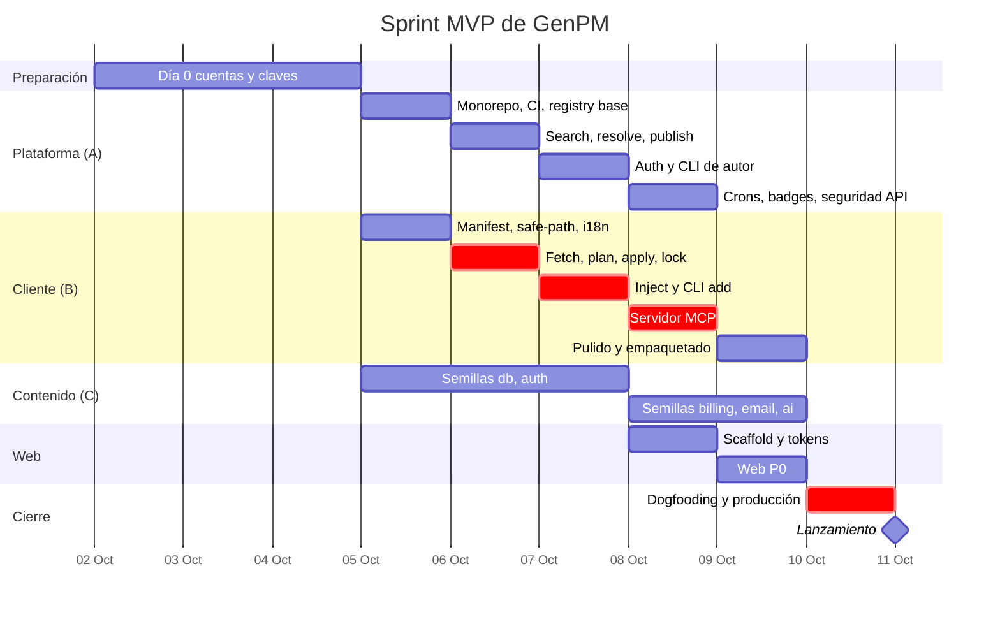
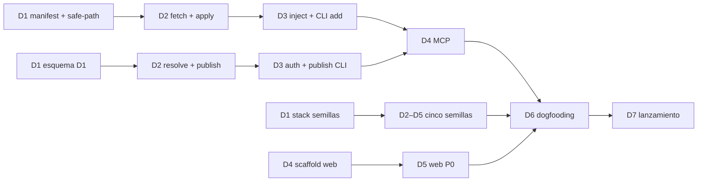

# Plan maestro — GenPM

> Estado: **v1** · Fecha: 2026-10-02 · Fuente: [docs/roadmap-mvp.md](../docs/roadmap-mvp.md) (si este plan contradice `docs/`, gana `docs/`).
> Las tareas ejecutables viven en los archivos de esta carpeta; el progreso está en [README.md](README.md).

## 1. Objetivo

Al final del **Día 7**, cualquier desarrollador puede ejecutar:

```bash
claude mcp add genpm -- npx -y @genpm/mcp
# "Crea la base de un SaaS: base de datos, login con GitHub, suscripciones con Stripe y emails"
```

Su agente busca, inspecciona e inyecta `@core/db`, `@core/auth`, `@core/billing` y `@core/email` desde el registry público,
con reglas de contexto con alcance, y deja la app integrada **sin que el humano edite código a mano**.

### Criterios de éxito (demo final grabada → tarea `D7-G-01`)

| # | Criterio | Se verifica en |
|---|---|---|
| 1 | `npx genpm search auth` responde desde producción en < 1 s | `D6-G-02` |
| 2 | `npx genpm add @core/billing` instala billing + auth + db, escribe contexto para Cursor y Claude Code, propone `pnpm add` y no escribe MCP sin consentimiento | `D3-G-01` |
| 3 | Instalación conversacional vía `@genpm/mcp` en Cursor y Claude Code | `D4-G-01` |
| 4 | `genpm publish` de un paquete nuevo aparece en genpm.net en < 1 min | `D6-G-03` |
| 5 | Las 5 semillas publicadas con escaneo `passed` | `D6-P-05` |

## 2. Fases y calendario

Fechas propuestas (equipo de 2 ingenieros + agentes IA). Con 1 persona, el sprint pasa a 10 días hábiles y se aplican los recortes 1–3 desde el inicio (§6).

| Fase | Fecha propuesta | Archivo | Hito al cerrar |
|---|---|---|---|
| Día 0 · Preparación | vie 2 – dom 4 oct | [00-dia-0-preparacion.md](00-dia-0-preparacion.md) | **M0** Cuentas, dominios y claves listos |
| Día 1 · Cimientos | lun 5 oct | [01-dia-1-cimientos.md](01-dia-1-cimientos.md) | **M1** CI verde en 3 SO, `/v1/health` en staging |
| Día 2 · Registry y fetch | mar 6 oct | [02-dia-2-registry-fetch.md](02-dia-2-registry-fetch.md) | **M2** Un fixture publicado se instala de punta a punta |
| Día 3 · CLI y contexto | mié 7 oct | [03-dia-3-cli-contexto.md](03-dia-3-cli-contexto.md) | **M3** `genpm add` funciona en los 3 SO (**checkpoint de recorte**) |
| Día 4 · Servidor MCP | jue 8 oct | [04-dia-4-mcp.md](04-dia-4-mcp.md) | **M4** Instalación conversacional en Claude Code y Cursor |
| Día 5 · Web y pulido | vie 9 oct | [05-dia-5-web.md](05-dia-5-web.md) | **M5** Web P0 en staging, 5 semillas aceptadas |
| Día 6 · Producción | sáb 10 oct | [06-dia-6-produccion.md](06-dia-6-produccion.md) | **M6** Puertas de seguridad en verde, npm publicado |
| Día 7 · Lanzamiento | dom 11 oct | [07-dia-7-lanzamiento.md](07-dia-7-lanzamiento.md) | **M7** Lanzado |
| Transversal · Semillas | Días 1–6 | [08-semillas.md](08-semillas.md) | 5 paquetes `@core/*` aceptados |
| Transversal · Marca y diseño | Días 0–6 | [09-marca-diseno.md](09-marca-diseno.md) | Activos de marca y preset de tokens listos |
| Post-MVP | +2 sem → +6 meses | [10-post-mvp.md](10-post-mvp.md) | v0.2 · v0.3 · v1.0 SaaS · Enterprise |



## 3. Tracks y responsables

| Track | Qué cubre | Responsable |
|---|---|---|
| **F** Fundador | Cuentas, dominios, pagos, contratación de revisores, decisiones | Fundador |
| **A** Plataforma | Registry (Workers + D1), auth, CLI de autor, seguridad de la API | Ingeniero 1 |
| **B** Cliente | `manifest`, `core`, CLI de consumidor, servidor MCP | Ingeniero 2 |
| **C** Contenido | 5 semillas, docs; mayormente agentes IA con revisión de A/B | Agentes IA + revisión |
| **W** Web | `apps/web` (A + C el Día 5) | Ingeniero 1 + agentes |
| **D** Diseño | Marca, activos, tokens | Fundador / diseñador |
| **T** Todos | Gates de cada día, dogfooding, lanzamiento | Equipo |

### Capacidad frente a carga

Suma de estimaciones del sprint (Días 0–7, semillas y marca; sin post-MVP) al crear este plan: **~355 h**.

| Track | Horas estimadas | Capacidad del sprint | Lectura |
|---|---|---|---|
| A + W (Ingeniero 1) | 73.5 + 54 = 127.5 h | ~60 h (6 días × 10 h) | Solo cabe si los agentes hacen la mayor parte de la web (W) |
| B (Ingeniero 2) | 97 h | ~60 h | **Sobrecargado.** Es además el camino crítico |
| C (agentes + revisión) | 54 h | Agentes en paralelo | Viable con revisión diaria |
| F + D (fundador) | 36.5 h | Día 0 + tardes | Viable |
| T (equipo) | 39.5 h | Compartido | Gates y dogfooding |

Decisión pendiente del fundador antes del Día 1: aplicar los recortes 1–3 desde el inicio, mover parte de B a agentes
(por ejemplo los adaptadores `D3-B-03` y `D4-B-06` y los snapshots `D3-B-11`), o ampliar el sprint a 10 días.
Recalcula con `pnpm tasks` (columna "Pendiente").

## 4. Camino crítico



El riesgo principal está en **D2–D3 del track B** (fetch, apply e inyección). Si al cerrar el Día 3 `genpm add` no funciona de punta a punta
(gate `D3-G-04`), se activa el plan de recorte.

## 5. Gates

Cada día termina con tareas `Dn-G-*` (track **T**). Un día no está cerrado hasta que sus gates están en `DONE`.
Las puertas de seguridad del Día 6 (`D6-S-*`) son **bloqueantes para lanzar**: ninguna se recorta.

## 6. Plan de recorte (en este orden)

Si hay que recortar, se marca la tarea con `pnpm tasks cut <ID>` y se anota el motivo debajo de la tarea.

| Orden | Recorte | Tareas afectadas |
|---|---|---|
| 1 | Adaptadores Copilot y Windsurf → solo AGENTS.md + Claude Code + Cursor | `D3-B-03` |
| 2 | Web: Publisher, Tokens y OG images | `D5-W-09`, `D5-W-11`, `D5-W-15` |
| 3 | `outdated`, `yank`, `doctor`, `mcp add/remove` → v0.1.1 | `D5-B-01`, `D3-A-07`, `D3-B-08` (doctor), `D4-B-06` (add/remove) |
| 4 | Fallback tarball → exigir `git` | `D2-B-03` (parte tarball) |
| 5 | Resolución de deps `g` → el CLI lista deps y pide instalarlas | `D2-A-02` (clausura) |
| 6 | 5 semillas → 3 (`db`, `auth`, `billing`) | `S-EM-*`, `S-AI-*` |

**Nunca se recorta:** los 10 invariantes de seguridad, la firma de manifiestos, el escaneo (registry y cliente),
las puertas de seguridad del Día 6 y los idiomas de nivel 1 (`en`, `es`, `pt-BR`).

## 7. Riesgos

| Riesgo | Señal temprana | Respuesta |
|---|---|---|
| Fetch por SHA falla en algún host o proxy | Tests del Día 2 | Fallback tarball (no recortar si aparece) |
| Cambian los formatos de reglas/MCP de los IDEs | Pruebas reales del Día 4 | Adaptadores aislados; priorizar AGENTS.md |
| Rate limits de GitHub al publicar semillas | Día 5 | Token de instalación de la GitHub App; publicar escalonado |
| Un agente no integra bien una semilla | Prueba de aceptación del Día 5 | Mejorar su `AGENTS.md` (es contenido) |
| Windows | CI del Día 1 | Matriz desde el día 1 |
| genpm.net no se consigue a tiempo | Día 0 | Lanzar en genpm.dev y redirigir después (decisión del fundador) |

## 8. Métricas de lanzamiento (2 semanas)

| Métrica | Objetivo |
|---|---|
| Instalaciones (`resolve` únicos por proyecto) | 1 000 |
| % de instalaciones vía MCP | ≥ 30 % |
| Paquetes de terceros | 25 |
| Publishers distintos | 15 |
| Estrellas del repo | 500 |
| `E_INTERNAL` / instalaciones | < 0,5 % |

## 9. Cómo se trabaja con las tareas

Ver [README.md](README.md). En resumen: `pnpm tasks next` para elegir, `pnpm tasks start <ID>` al empezar,
`pnpm tasks done <ID>` al terminar (con su DoD cumplido) y `pnpm tasks` para ver el estado.
